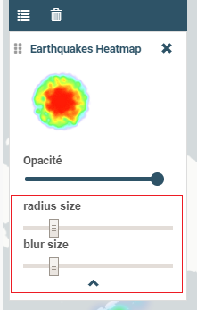

.. Authors :
.. mviewer team

.. _customcontrol:

Développer un customControl
###########################

Les **Customs Controls** permettent de créer des interactions entre l'utilisateur et un layer. Si on souhaite créer une nouvelle fonctionnalité en lien avec une couche particulière, c'est la solution à privilégier.
Le mécanisme de customControl permet le développement à façon de solution nouvelle sans modifier le coeur de mviewer.

.. admonition:: Convention

   Un custom control consiste en deux fichiers - **JavaScript** et **HTML**. Ces deux fichiers doivent impérativement respecter la règle de nommage suivante :

    - **layerid**.html
    - **layerid**.js
    - *où layerid correspond à l'id du layer tel que définit dans le config.xml.*

    L'emplacement de ces fichiers doit être précisé dans le config.xml avec le paramètre ``customcontrolpath=""``

.. sidebar:: Exemple :

    Le custom control - encadré rouge -  s'affiche par défaut dans la légende en dessous des attributions :

Ecrire le code - html
**************************

Le bloc écrit en HTML s'affichera dans le panneau légende associé à la couche. Il est possible de créer des éléments HTML qui permettront à l'utilisateur d'interagir avec la couche associée.
Dans l'exemple suivant, on affiche deux sliders qui vont nous permettre de modifier dynamiquement l'affichage de notre couche.

.. code-block:: HTML
    :caption: customcontrol.html
    :emphasize-lines: 7-8

    <form>
        <label>radius size</label>
        <input id="heatmap-radius" class="" type="range" min="1" max="50" step="1" value="10"/>
        <label>blur size</label>
        <input id="heatmap-blur" type="range" min="1" max="50" step="1" value="10"/>
    </form>

*Tooltip*

Si vous souhaitez utiliser une infobulle (tooltip), vous pouvez utiliser les paramètres `title` et `tooltip` :

.. code-block:: HTML
    :caption: customcontrol.html
    :emphasize-lines: 7-8
    
    <button tooltip="top,hover,true,body,mviewer.templates.tooltip" title="Déplacement en voiture">

.. csv-table:: Paramètres à utiliser :
        :header: "Paramètre", "Description", "Exemple"

        "tooltip","Permet de définir les options de la tooltip","<placement - string>, <trigger - string>, <html - boolean>, <container - string>, <template, string>"
        "title","Texte affiché","title='Déplacement en voiture'"

Ecrire le code - JavaScript
********************************

Les fichiers JavaScript des custom controls sont récupérés avec ``fetch``, puis exécutés par des éléments ``<script>`` classiques dans ``configuration.js``. Le callback de ``fetch`` ne donne pas de portée locale au code chargé, et retirer l'élément ``<script>`` après exécution ne supprime pas ses déclarations globales.

Chaque exemple enveloppe donc tout le contrôle dans une fonction immédiatement invoquée (IIFE). Les variables ``layerid`` et ``cc`` restent locales : plusieurs contrôles peuvent utiliser ces noms sans provoquer d'erreur de redéclaration. Utiliser ``var`` au niveau global conserverait un risque d'écrasement entre scripts. Dans cette portée locale, on utilise ``const`` pour les références non réaffectées et ``let`` pour l'état modifiable.

La méthode ``destroy()`` retire les écouteurs ajoutés par ``init()`` et libère les références aux éléments DOM et à la couche. Le contrôle peut ensuite être initialisé à nouveau lors de la réouverture du panneau.

Ancienne méthode
======================

La ligne surlignée enregistre directement le contrôle dans ``mviewer.customControls``.

.. code-block:: javascript
    :caption: customcontrol.js
    :linenos:
    :emphasize-lines: 17

    (function() {
        const layerid = "heatmap";

        let _initialized = false;
        let _layer;
        let _blurElement = null;
        let _radiusElement = null;

        const _blurHandler = function(e) {
            _layer.setBlur(parseInt(e.target.value, 10));
        };

        const _radiusHandler = function(e) {
            _layer.setRadius(parseInt(e.target.value, 10));
        };

        mviewer.customControls[layerid] = {
            init: function () {
                // Code exécuté lorsque la couche est ajoutée à la légende.
                if (!_initialized) {
                    _layer = mviewer.getLayer(layerid).layer;
                    _blurElement = document.getElementById('heatmap-blur');
                    _radiusElement = document.getElementById('heatmap-radius');
                    if (_blurElement && _radiusElement) {
                        _blurElement.addEventListener('change', _blurHandler);
                        _radiusElement.addEventListener('change', _radiusHandler);
                        _initialized = true;
                    }
                }
            },

            destroy: function () {
                // Code exécuté lorsque le panneau de la couche est fermé.
                if (_blurElement) {
                    _blurElement.removeEventListener('change', _blurHandler);
                }
                if (_radiusElement) {
                    _radiusElement.removeEventListener('change', _radiusHandler);
                }
                _blurElement = null;
                _radiusElement = null;
                _layer = null;
                _initialized = false;
            }
        };
    }());

Nouvelle méthode
======================

Depuis la version **3.2** de mviewer, la classe ``CustomControl`` permet d'enregistrer les méthodes ``init`` et ``destroy`` du contrôle. Les lignes surlignées montrent la définition de l'objet local ``cc`` et son enregistrement.

.. code-block:: javascript
    :caption: customcontrol.js
    :linenos:
    :emphasize-lines: 17,47

    (function() {
        const layerid = "heatmap";

        let _initialized = false;
        let _layer;
        let _blurElement = null;
        let _radiusElement = null;

        const _blurHandler = function(e) {
            _layer.setBlur(parseInt(e.target.value, 10));
        };

        const _radiusHandler = function(e) {
            _layer.setRadius(parseInt(e.target.value, 10));
        };

        const cc = {
            init: function () {
                // Code exécuté lorsque la couche est ajoutée à la légende.
                if (!_initialized) {
                    _layer = mviewer.getLayer(layerid).layer;
                    _blurElement = document.getElementById('heatmap-blur');
                    _radiusElement = document.getElementById('heatmap-radius');
                    if (_blurElement && _radiusElement) {
                        _blurElement.addEventListener('change', _blurHandler);
                        _radiusElement.addEventListener('change', _radiusHandler);
                        _initialized = true;
                    }
                }
            },

            destroy: function () {
                // Code exécuté lorsque le panneau de la couche est fermé.
                if (_blurElement) {
                    _blurElement.removeEventListener('change', _blurHandler);
                }
                if (_radiusElement) {
                    _radiusElement.removeEventListener('change', _radiusHandler);
                }
                _blurElement = null;
                _radiusElement = null;
                _layer = null;
                _initialized = false;
            }
        };

        new CustomControl(layerid, cc.init, cc.destroy);
    }());

.. note::
    Pour exposer une méthode publique supplémentaire, ajoutez-la explicitement au contrôle enregistré dans ``mviewer.customControls[layerid]``. Avec la nouvelle méthode, conservez l'instance retournée par ``new CustomControl(...)`` dans une variable locale et ajoutez-y cette méthode. Elle sera accessible via ``mviewer.customControls["heatmap"].maMethode()``. Il n'est pas nécessaire d'exposer ``cc`` comme variable globale.

Ecrire le config.xml
*********************

Dans le fichier de configuration, à partir de l'exemple customLayer **heatmap**, il faut ajouter les 3 lignes mises en surbrillance.

.. code-block:: XML
    :caption: config.xml
    :emphasize-lines: 7-8

    <layer id="heatmap"
        name="Earthquakes Heatmap"
        visible="true"
        url="demo/heatmap/customlayer.js"
        queryable="true"
        type="customlayer"
        customcontrol="true"
        customcontrolpath="demo/heatmap/control"
        legendurl="demo/heatmap/legend.png"
        opacity="1"
        expanded="true"
        attribution=""
        metadata=""
        metadata-csw="">
    </layer>

.. Note::
    Pour aller plus loin :

    - :ref:`customcontroldev`
    - :ref:`publicfonctions`
